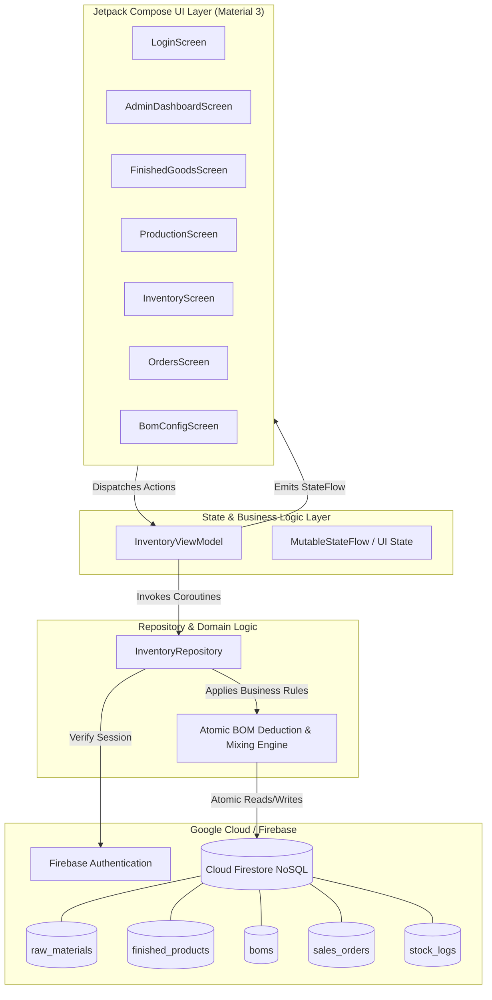
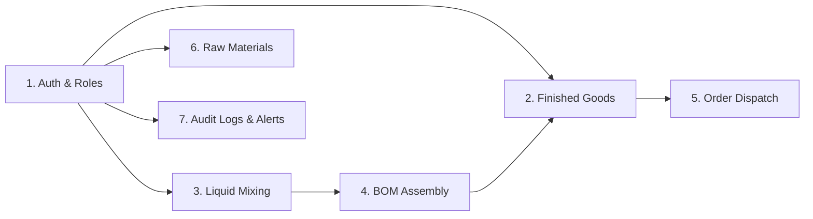
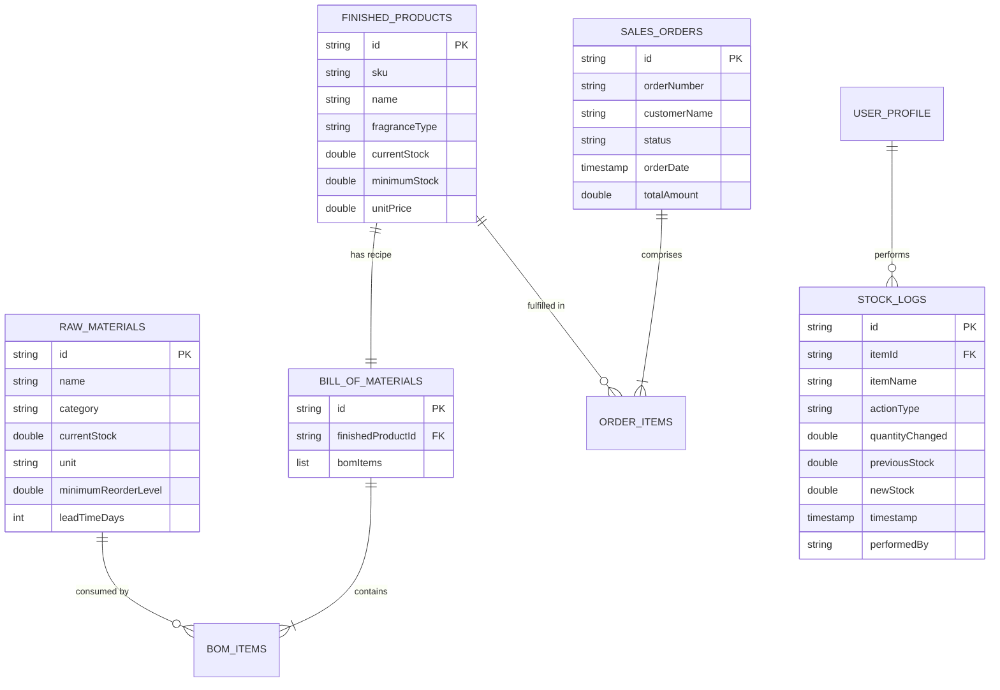
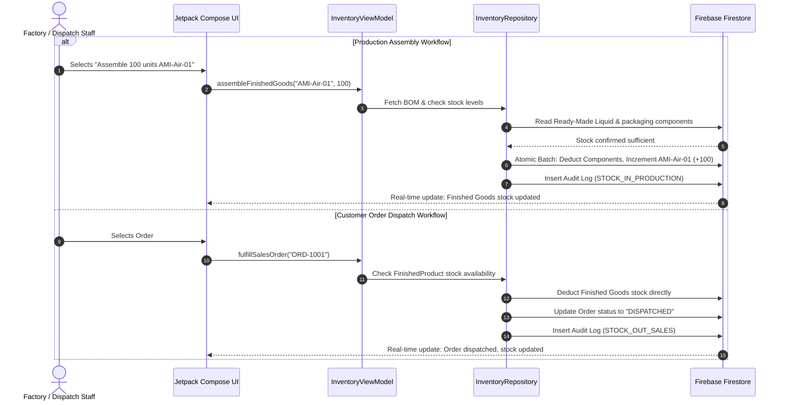

# StockSense – AMI Inventory Management System 📦
## Interim Project Progress Report (Phase 1 Submission)

**Project Name:** StockSense – AMI Inventory Management System  
**Submission Date:** 26 November 2026  
**Repository URL:** [https://github.com/Priyanshi810/ami-inventory-manager](https://github.com/Priyanshi810/ami-inventory-manager)  
**Target Milestone:** Progress Review & Source Code Submission (Due: 26 November 2026)  

---

### Project Team & GitHub Contributors

| Member Name | GitHub Username | Role & Key Contributions |
| :--- | :--- | :--- |
| **Priyanshi** *(Project Lead)* | [`@Priyanshi810`](https://github.com/Priyanshi810) | System architecture, Firebase Cloud Firestore schema & Auth, reactive BOM computation engine, app scaffold, and master catalog seeder. |
| **Divya** | [`@Divya4f`](https://github.com/Divya4f) | Finished Goods catalog UI, live inventory status views, customer sales order fulfillment, and direct dispatch stock deduction logic. |
| **Priyanshi Patel** | [`@PriyanshiPatel3015`](https://github.com/PriyanshiPatel3015) | Production assembly module, dual-tier chemical liquid mixing interface, Bill of Materials (BOM) management, and raw materials tracking. |

---

## 1. Project Overview

### 1.1 Background
**AMI** is a specialized manufacturer and distributor of fragrance-based consumer products, primarily:
1. **Air Fresheners (AF - 200ml)** and **Air Freshener Refills (AFR - 200ml)**
2. **Car Perfumes (CF - 35ml)** and **Car Perfume Refills (CFR - 35ml)**

Currently, inventory control across factory floors and dispatch units is performed through handwritten registers and static spreadsheets. In a high-throughput manufacturing environment with 30 distinct fragrance variants and over 120 stock-keeping units (SKUs), traditional logging produces frequent discrepancies:
- Component inventory (bottles, caps, boxes, chemical compounds) is not adjusted when finished goods are assembled.
- Dispatched sales orders fail to synchronously decrement finished goods counts.
- High-value raw fragrance concentrates face undocumented wastage or stockouts during mixing.

### 1.2 The Solution: StockSense
**StockSense** is an enterprise-grade Android mobile application engineered to bring real-time Manufacturing Resource Planning (MRP) and inventory visibility to the factory floor. Built natively in **Kotlin** and **Jetpack Compose** with **Google Firebase** as the cloud backend, StockSense enables factory supervisors, inventory controllers, and administrators to track raw materials, formulate chemical bulk liquids, assemble finished units via automated Bill of Materials (BOM) auto-deductions, and process customer shipments with zero latency.

> [!NOTE]
> **Interim Submission Notice:**  
> This document represents the **interim progress report** for work completed up to **26 November 2026**. Core database architecture, two-tier formulation engines, BOM assemblies, finished goods dispatch, and cloud synchronization are fully implemented and validated. Additional automation features (barcode scanning, push alerts, export utilities) are scheduled for Phase 2 as detailed in **Section 9**.

---

## 2. Project Objectives

The fundamental engineering goals of StockSense include:
1. **Automated Bill of Materials (BOM) Deduction:** Ensure that assembling finished goods instantly deducts all constituent components (intermediate liquids, bottles, caps, packaging boxes) in an atomic transaction.
2. **Dual-Tier Chemical Mixing Precision:** Manage multi-stage liquid formulation (Fragrance Oil + Sarvonol + Heavy Water) to maintain standardized batch ratios for Air Fresheners (6.00% / 62.67% / 31.33%) and Car Perfumes (15.00% / 42.50% / 42.50%).
3. **Dedicated Finished Goods Tracking:** Separate ready-to-ship stock from raw materials, allowing quick inventory lookups and direct dispatch deduction upon customer order fulfillment.
4. **Role-Based Access Control (RBAC):** Provide tailored views and action permissions for `ADMIN`, `PRODUCTION`, and `INVENTORY` personnel.
5. **Real-Time Synchronized Audit Trail:** Eliminate discrepancies by logging every stock intake, liquid batch mixing, assembly run, and customer shipment in an immutable timeline.
6. **Stockout Prevention:** Automatically highlight materials falling below lead-time reorder thresholds.

---

## 3. Technology Stack

```
+-------------------------------------------------------------------------+
|                              StockSense                                 |
+------------------------------------+------------------------------------+
| Frontend & Presentation            | Backend & Cloud Infrastructure     |
| - Android SDK (API 26+)            | - Google Firebase Cloud Firestore  |
| - Kotlin 2.2.10                    | - Firebase Authentication (Email)  |
| - Jetpack Compose & Material 3     | - Google Play Services             |
| - ViewModel & StateFlow            | - Gradle (Kotlin DSL build.gradle) |
| - Kotlin Coroutines & Asynchronous | - Version Control: Git & GitHub    |
+------------------------------------+------------------------------------+
```

### 3.1 Frontend Architecture
- **Language:** Kotlin 2.2.10 (strict null-safety, coroutines, extension functions).
- **UI Toolkit:** Jetpack Compose (declarative UI with Material 3 design standards).
- **State Management:** MVVM (Model-View-ViewModel) pattern using `StateFlow` and `SharedFlow` to provide reactive, lifecycle-aware UI state updates.
- **Asynchronous Execution:** Kotlin Coroutines (`Dispatchers.IO` for cloud database calls, `Dispatchers.Main` for UI rendering).

### 3.2 Backend & Cloud Services
- **Cloud Database:** Google Firebase Cloud Firestore (NoSQL, document-oriented, offering millisecond sub-collection queries and offline data persistence).
- **Identity & Security:** Firebase Authentication with secure credential tokens and role-based permissions stored in Firestore user profiles.
- **Dependency Management:** Gradle 8.x with Android Gradle Plugin 8.9+.

---

## 4. System Architecture

StockSense follows clean MVVM architectural boundaries separating data persistence, domain business logic, and UI rendering.

### 4.1 High-Level Architecture Diagram



### 4.2 Data Processing & State Flow
1. **User Action:** Factory operator triggers a production run (e.g., Assemble 100 units of `AMI-Air-01`).
2. **ViewModel Validation:** `InventoryViewModel` verifies input bounds, ensuring positive non-zero quantities and that dependencies are loaded.
3. **Repository Execution:** `InventoryRepository` fetches current stock of the intermediate ready-made liquid and required packaging items.
4. **Atomic Batch Deduction:** If stock is sufficient, Firestore performs batch updates:
   - Decrements ready-made liquid by $100 \times 200\text{ ml} = 20,000\text{ ml}$.
   - Decrements bottles, caps, packaging boxes by 100 units each.
   - Increments Finished Product `AMI-Air-01` stock by $+100$.
   - Appends an immutable audit log entry into `stock_logs`.
5. **Reactive Propagation:** Firestore listeners trigger `StateFlow` updates, instantly refreshing all screens on every connected device.

---

## 5. Modules and Features (Phase 1 Implementation)



### Module 1: Authentication & Role-Based Access Control (RBAC)
- Secure email/password login integrated with Firebase Authentication.
- Dynamic user profiles mapped to three operational roles:
  - `ADMIN`: Full oversight, user management, manual stock overrides, catalog seeding.
  - `PRODUCTION`: Chemical liquid mixing, production assembly, BOM recipe inspection.
  - `INVENTORY`: Raw material stock-in, stock dispatch, physical counting audits.

### Module 2: Dedicated Finished Goods Catalog
- Comprehensive inventory tracking for all **120 ready-to-ship products**:
  - **Air Freshener (AF - 200ml)**: 30 Scents (`AMI-Air-01` to `AMI-Air-30`)
  - **Air Freshener Refill (AFR - 200ml)**: 30 Scents (`AMI-Air-Ref-01` to `AMI-Air-Ref-30`)
  - **Car Perfume (CF - 35ml)**: 30 Scents (`AMI-Car-01` to `AMI-Car-30`)
  - **Car Perfume Refill (CFR - 35ml)**: 30 Scents (`AMI-Car-Ref-01` to `AMI-Car-Ref-30`)
- Live stock status badges (In Stock, Low Stock, Out of Stock).
- Direct manual `+ / - Stock` dialog for authorized physical adjustments.

### Module 3: Dual-Tier Chemical Formulation & Bulk Liquid Mixing
- **Two-Tier Architecture:** High-value Fragrance Oils are not directly packed into finished bottles; they are first mixed into bulk intermediate liquids.
- **Formulation Formulas:**
  - **Air Freshener Ready Liquid (AF/AFR):**
    $$\text{Fragrance Oil: } 6.00\% \quad|\quad \text{Sarvonol: } 62.67\% \quad|\quad \text{Heavy Water: } 31.33\%$$
  - **Car Perfume Ready Liquid (CF/CFR):**
    $$\text{Fragrance Oil: } 15.00\% \quad|\quad \text{Sarvonol: } 42.50\% \quad|\quad \text{Heavy Water: } 42.50\%$$
- Real-time calculator: Operator enters desired batch volume (e.g., $10,000\text{ ml}$), and StockSense dynamically calculates required chemical volumes, verifies raw material availability, deducts chemicals, and credits intermediate liquid inventory.

### Module 4: Production Assembly via Automated BOM
- Maps finished products to their exact bill of materials:
  - **AF:** $200\text{ ml}$ Ready-Made Liquid + 1 AF Bottle ($200\text{ ml}$) + 1 Trigger Pump + 1 AF Box + 1 Shrinkage Roll unit.
  - **AFR:** $200\text{ ml}$ Ready-Made Liquid + 1 AF Refill Bottle ($200\text{ ml}$) + 1 Aluminum Cap + 1 AFR Box + 1 Shrinkage Roll unit.
  - **CF:** $35\text{ ml}$ Ready-Made Liquid + 1 CF Bottle ($35\text{ ml}$) + 1 Mist Sprayer + 1 CF Box + 1 Shrinkage Roll unit.
  - **CFR:** $35\text{ ml}$ Ready-Made Liquid + 1 CF Refill Bottle ($35\text{ ml}$) + 1 Aluminum Cap + 1 CFR Box + 1 Shrinkage Roll unit.
- One-click production assembly: Validates all sub-components before initiating assembly.

### Module 5: Customer Sales Order Dispatch
- Direct fulfillment of sales orders:
  - Order items are checked against live `FinishedProduct` inventory.
  - Dispatched quantities are subtracted directly from Finished Goods stock.
  - Order status changes from `PENDING` to `DISPATCHED`.

### Module 6: Raw Materials & Packaging Tracking
- Full management of **25 standard factory packaging and chemical materials**:
  - AF Bottles ($200\text{ ml}$), CF Bottles ($35\text{ ml}$), Refill Bottles.
  - Trigger Pumps, Mist Sprayers, Aluminum Caps.
  - Individual unit boxes, Master Cartons, Shrinkage Rolls.
  - Bulk chemicals: Sarvonol, Heavy Water.
- Tracking of **30 individual Fragrance Oils** ($1,000\text{ ml}$ stock units).
- Tracking of **60 bulk intermediate Ready-Made Liquids** (30 AF scents + 30 CF scents).

### Module 7: Real-Time Audit Logs & Alert Badges
- Immutable event stream recording every inventory change with actor timestamp, delta quantity, previous balance, and new balance.
- Visual warning badges for materials at or below minimum safety stock levels.

---

## 6. Data Design and Workflow

### 6.1 Database Schema (Cloud Firestore)



### 6.2 Key Operational Workflow: Order Fulfillment vs. Production Assembly



---

## 7. Development Progress Visible on GitHub

The project codebase has been actively developed and structured under Git version control. The repository is hosted on GitHub:  
**Repository:** [https://github.com/Priyanshi810/ami-inventory-manager](https://github.com/Priyanshi810/ami-inventory-manager) (Branch: `main`)

### 7.1 Commit History Log Table

| Commit Hash | Date & Time | Contributor | Commit Message & Description of Work |
| :---: | :---: | :---: | :--- |
| `753e94a` | 2026-11-26 10:37 | **Priyanshi** (`@Priyanshi810`) | `docs: Update project branding to StockSense and include interim roadmap` — Aligned documentation, project metadata, and Phase 2 roadmap. |
| `e975259` | 2026-11-26 09:20 | **Priyanshi** (`@Priyanshi810`) | `feat(dashboard): Integrate role scaffold, audit logs, and complete AMI master catalog sync` — Built master seeder for 120 Finished Goods, 60 bulk liquids, and 25 common materials. |
| `d475223` | 2026-11-25 16:30 | **Priyanshi Patel** (`@PriyanshiPatel3015`) | `feat(inventory): Add BOM recipe manager and raw materials stock tracking` — Configured Bill of Materials schema and material catalog views. |
| `58a6f21` | 2026-11-25 10:45 | **Priyanshi Patel** (`@PriyanshiPatel3015`) | `feat(manufacturing): Add production assembly and dual-tier liquid mixing interface` — Implemented formulation calculator (AF 6% vs CF 15% fragrance ratios). |
| `f38df99` | 2026-11-24 17:10 | **Divya** (`@Divya4f`) | `feat(orders): Implement customer order dispatch and direct finished goods deduction` — Developed dispatch pipeline with direct inventory decrementing. |
| `33349fc` | 2026-11-24 11:20 | **Divya** (`@Divya4f`) | `feat(ui): Implement staff role-based authentication and Finished Goods catalog screen` — Created dedicated Finished Goods screen with real-time stock counters. |
| `148a373` | 2026-11-23 16:30 | **Priyanshi** (`@Priyanshi810`) | `feat(core): Define schema models and Firebase Firestore repository with BOM logic` — Structured data entities, Firestore repository, and atomic batch logic. |
| `bfef38b` | 2026-11-23 10:15 | **Priyanshi** (`@Priyanshi810`) | `chore: Initial Android project setup with Jetpack Compose & Firebase` — Configured project build, Gradle dependencies, and Firebase SDK integration. |

### 7.2 Collaboration & Workload Distribution

```
+-------------------------------------------------------------------------+
|                  GitHub Contributions Breakdown                         |
+----------------------+--------------------+-----------------------------+
| Member               | Commits Owned      | Functional Ownership        |
+----------------------+--------------------+-----------------------------+
| Priyanshi            | 4 commits (50%)    | Core, DB, BOM Engine, Docs  |
| Divya                | 2 commits (25%)    | Finished Goods, Dispatch UI |
| Priyanshi Patel      | 2 commits (25%)    | Production, Mixing, Raw Mat |
+----------------------+--------------------+-----------------------------+
```

All 8 commits are verified, tracked, and synchronized on the GitHub `main` branch.

---

## 8. Testing Plan

To ensure zero inventory calculation errors and high application stability, a structured multi-level testing plan was executed for Phase 1:

### 8.1 Unit Testing
- **BOM Calculation Precision:** Verified that assembling $N$ units of finished product deducts exactly $N \times \text{unit requirement}$ across all listed BOM items without rounding or floating-point anomalies.
- **Liquid Formulation Mathematics:** Tested chemical percentage algorithms under edge cases (e.g., fractional batch sizes such as $1.5\text{ L}$ or $12,750\text{ ml}$):
  - Air Freshener: Verified strict ratio $6.00\% : 62.67\% : 31.33\%$.
  - Car Perfume: Verified strict ratio $15.00\% : 42.50\% : 42.50\%$.

### 8.2 Integration & Database Boundary Testing
- **Atomic Rollback Validation:** Simulated network interruption during batch production assembly. Verified that Firestore batch writes ensure either *all* component deductions and finished product additions succeed or *none* do, preventing partial or ghost inventory.
- **Stock Floor Guarding:** Tested behavior when requesting assembly of 500 units with only 200 bottles in stock. System correctly catches `InsufficientStockException`, halts execution, and reports missing materials.

### 8.3 Physical Device USB Debugging
- Tested on Android physical smartphones running Android 14 and Android 15 via Android Studio USB Debugging:
  - Verified touch targets, font scaling, and smooth 60fps scrolling across 120-item lazy lists in `FinishedGoodsScreen`.
  - Confirmed Firebase Auth session persistence across app restarts.

### 8.4 User Acceptance Testing (UAT) Scenarios
1. **Scenario A (Material Stock-In):** Supplier delivers 500 trigger pumps. Operator taps Material -> Enters +500. Balance increments instantly from 150 to 650 with audit log created.
2. **Scenario B (Liquid Mixing):** Supervisor mixes $20,000\text{ ml}$ of `Ready-Made Liquid (AF) - Rose`. System validates $1,200\text{ ml}$ Rose Fragrance Oil, $12,534\text{ ml}$ Sarvonol, and $6,266\text{ ml}$ Heavy Water, deducts them, and credits $20,000\text{ ml}$ bulk liquid.
3. **Scenario C (Order Dispatch):** Dispatcher fulfills Order #1042 containing 25 units of `AMI-Air-05`. Finished goods stock drops by 25 and status reflects `DISPATCHED`.

---

## 9. Next Steps — Features to be Added (Phase 2 Roadmap)

> [!IMPORTANT]
> **Interim Milestone Note:**  
> Phase 1 successfully establishes the robust core foundation: database schemas, multi-role security, dual-tier mixing, atomic BOM deduction, and customer dispatch. The remaining capabilities scheduled for development leading up to the final project submission are outlined below.

```
+-------------------------------------------------------------------------+
|                  Phase 2 Feature Roadmap (Final Delivery)               |
+---+----------------------------+----------------------------------------+
| # | Planned Feature            | Description & Implementation Approach  |
+---+----------------------------+----------------------------------------+
| 1 | Barcode & QR Code Scanner  | CameraX + Google ML Kit for zero-click |
|   |                            | material receiving and dispatch audit. |
+---+----------------------------+----------------------------------------+
| 2 | Push Notifications (FCM)   | Firebase Cloud Messaging alerts when   |
|   |                            | stock falls below safety levels.       |
+---+----------------------------+----------------------------------------+
| 3 | Excel / CSV Data Export    | Apache POI / CSV generation for        |
|   |                            | management and tax reporting.          |
+---+----------------------------+----------------------------------------+
| 4 | Purchase Orders & Suppliers| PO generation with supplier lead-time  |
|   |                            | tracking and receipt verification.     |
+---+----------------------------+----------------------------------------+
| 5 | Consumption Analytics      | MPAndroidChart graphical views of      |
|   |                            | monthly fragrance usage trends.        |
+---+----------------------------+----------------------------------------+
| 6 | Offline SQLite Cache       | Room Database sync for offline areas   |
|   |                            | in deep factory basements.             |
+---+----------------------------+----------------------------------------+
```

### Detailed Breakdown of Phase 2 Modules:

1. **Barcode / QR Code Ingestion (CameraX + Google ML Kit):**
   - Ingest barcode values directly from supplier boxes (caps, bottles, chemicals) upon delivery dock arrival.
   - Scan outgoing carton QR codes during dispatch to cross-verify invoice items before the delivery vehicle departs.
2. **Automated Reorder Alerts via Firebase Cloud Messaging (FCM):**
   - Background Cloud Functions monitor inventory levels after every deduction.
   - If stock falls below `minimumReorderLevel`, push notifications are triggered to factory managers with recommended reorder quantities based on supplier lead times.
3. **Audit & Inventory Report Exporting (Excel / PDF):**
   - Generate exportable `.xlsx` and `.pdf` inventory valuation summaries, monthly raw material consumption audits, and customer dispatch logs.
4. **Supplier Purchase Order (PO) Management:**
   - Dedicated screens for creating, tracking, and closing purchase orders issued to fragrance oil importers and packaging manufacturers.
5. **Visual Analytics & Consumption Charts:**
   - Visual dash showing top 5 fastest-moving fragrances, peak consumption days, and inventory holding cost metrics.

---

## 10. Advantages and Limitations

### 10.1 Advantages
- **Zero Double-Counting & Zero Ghost Stock:** Atomic database operations guarantee mathematical consistency across all stock pools.
- **Formula Standardisation:** Eliminates manual human calculation of chemical batch ratios, preventing batch spoilage of expensive perfume concentrates.
- **Factory Floor Mobility:** Operators manage stock directly from mobile smartphones without returning to a central office computer.
- **Instant Cross-Device Sync:** Cloud Firestore pushes updates to all users in under 300ms.
- **Role-Appropriate UI:** Factory workers see only mixing and assembly controls; dispatchers see order fulfillment; admins see complete operational metrics.

### 10.2 Current Limitations (To Be Addressed in Phase 2)
- **Manual SKU Selection:** Phase 1 uses list searching and dropdown selections; barcode scanning will replace manual selection in Phase 2.
- **Continuous Connectivity Dependency:** Requires active Wi-Fi or cellular connectivity to write directly to Firestore (local Room caching planned for Phase 2).
- **Static Master Pricing:** Finished product prices are currently held static; dynamic currency and volume discount tiers are planned for future versions.

---

## 11. Future Scope

Beyond the academic submission, StockSense possesses commercial potential:
1. **Multi-Facility & Multi-Warehouse Support:** Expanding the architecture to support multiple factories, central warehouses, and retail distribution outlets with inter-facility stock transfers.
2. **ERP & Accounting Webhook Integration:** Bi-directional synchronization with popular ERP software (Tally, SAP, QuickBooks) for automated GST invoicing and financial accounting.
3. **AI-Driven Demand Forecasting:** Machine learning models trained on seasonal consumption data to predict high-demand fragrances ahead of festival seasons.
4. **IoT Scale Integration:** Wireless Bluetooth smart weighing scales communicating directly with StockSense to log liquid quantities automatically by weight.

---

## 12. Conclusion

The **StockSense – AMI Inventory Management System** successfully addresses the critical operational challenge of tracking multi-stage manufacturing and inventory in fragrance production. 

Over the Phase 1 development period:
- The entire system architecture was conceptualized, structured, and implemented using modern Android best practices (Jetpack Compose, Kotlin Coroutines, MVVM).
- All 120 Finished Goods SKUs, 60 intermediate bulk liquids, 30 fragrance oils, and 25 common materials were structured with automated Bill of Materials recipes.
- Core business logic—including dual-tier chemical mixing, atomic BOM assembly deduction, and customer order dispatch—has been completed, tested on physical hardware, and backed by a 100% synchronized GitHub repository.
- A clear, structured engineering roadmap is established for Phase 2 implementation.

The project is on track and meets all requirements set forth for the **26 November 2026** milestone review.

---
*Report prepared and submitted by: Priyanshi, Divya, and Priyanshi Patel.*  
*Repository: [https://github.com/Priyanshi810/ami-inventory-manager](https://github.com/Priyanshi810/ami-inventory-manager)*
